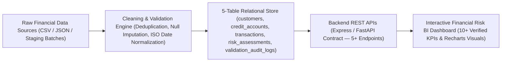

# CreditVision — Financial Risk Analytics & Data Processing (with SyncMind Enterprise Workflow Intelligence)

**Live Deployment:** [https://sync-mind-wine.vercel.app/](https://sync-mind-wine.vercel.app/)

## 1. Project Overview

**CreditVision — Financial Risk Analytics & Data Processing** is an independently developed financial analytics, transaction data-processing, and enterprise workflow intelligence platform designed for FinTech platforms, product-based technology companies, data engineering teams, and backend/BI engineering roles.

### The Financial Data-Processing Problem
Raw transaction feeds from commercial credit lines, trade finance instruments, and corporate cards frequently arrive with inconsistent timestamp formats, missing merchant category codes, duplicate settlement IDs, and out-of-bounds drawdown amounts. Without deterministic validation and relational normalization, downstream risk dashboards misstate delinquency rates (30+ DPD) and credit utilization exposure.

### How CreditVision & SyncMind Solve It
1. **Financial Transaction Data Processing & Validation (`src/core/creditVisionEngine.ts`)**:
   - Deduplicates primary transaction keys (`transaction_id`), imputes missing categorical fields (`merchant_category`) with explicit audit trail markers, normalizes non-ISO date strings into `YYYY-MM-DD HH:mm:ss`, and rejects invalid negative drawdown amounts.
2. **Normalized 5-Table Relational Data Model**:
   - Organizes financial domain records across 5 structured relational tables: `customers`, `credit_accounts`, `transactions`, `risk_assessments`, and `validation_audit_logs`.
3. **Backend REST API Services (`server.ts`)**:
   - Exposes 5 dedicated financial risk endpoints (`/api/creditvision/overview`, `/api/creditvision/kpis`, `/api/creditvision/transactions`, `/api/creditvision/risk-summary`, `/api/creditvision/validate-batch`) alongside enterprise workflow & meeting intelligence endpoints.
4. **Interactive Financial Risk & BI Dashboard (`src/components/CreditVisionView.tsx`)**:
   - Computes 10 verified descriptive credit risk KPIs (Batch Records Audited, Validation Pass Rate, Net Portfolio Exposure, Avg Credit Utilization, Avg Debt-to-Income Ratio, 30+ DPD Delinquency Rate, High-Risk Exposure Share, Flagged Risk Transactions, Imputed & Cleaned Rows, Active Credit Accounts) and visualizes multi-axis volume, delinquency, and risk-tier concentration charts.

---

## 2. System Architecture



---

## 3. Verified Technology Stack

| Category | Verified Implementation |
| :--- | :--- |
| **Programming & Data Processing** | TypeScript 5 / Node.js Data Validation Engine · Python & Pandas Data Cleaning Specification |
| **Backend & APIs** | Express.js Full-Stack REST API Server (`server.ts`) · FastAPI Schema Contract Compatible |
| **Database & Storage** | 5-Table Normalized Relational Model (MySQL 8.0 / PostgreSQL DDL Schema + Persistent JSON Store `data/syncmind-db.json`) |
| **Analytics & Visualization** | React 19 + Tailwind CSS v4 + Recharts Interactive BI Charts · Power BI KPI Specification |

---

## 4. Backend REST API Reference

### CreditVision Financial Risk APIs
| Method | Endpoint | Description |
| :--- | :--- | :--- |
| `GET` | `/api/creditvision/overview` | Returns full 5-table relational dataset, schema metadata, and 10 calculated KPIs. |
| `GET` | `/api/creditvision/kpis` | Returns the 10 verified financial risk and data validation KPIs. |
| `GET` | `/api/creditvision/transactions` | Returns validated, imputed, and rejected transactions with `riskTier` and `segment` filters. |
| `GET` | `/api/creditvision/risk-summary` | Returns risk tier exposure distribution, 6-month delinquency trends, and account risk assessments. |
| `POST` | `/api/creditvision/validate-batch` | Executes live primary-key deduplication, null imputation, ISO date normalization, and risk tiering on a submitted batch. |

### Enterprise Workflow & Meeting Intelligence APIs
| Method | Endpoint | Description |
| :--- | :--- | :--- |
| `GET` | `/api/state` | Returns the complete structured workspace state (`AppDatabaseState`). |
| `POST` | `/api/state/reset` | Resets workspace to the initial Enterprise FinTech & AI baseline. |
| `POST` | `/api/meetings` | Creates a validated meeting record with duplicate submission checks. |
| `POST` | `/api/meetings/ingest` | Ingests `TXT`, `CSV`, or `JSON` meeting payloads with optional auto-extraction. |
| `POST` | `/api/ai/analyze-meeting` | Extracts structured summary, discussion points, decisions, action items, dependencies, and blockers. |
| `GET` | `/api/analytics` | Calculates live KPIs, owner workload distribution, weekly trends, and data quality summary. |
| `GET` | `/api/data-quality` | Evaluates workspace schema validity and foreign-key referential integrity. |

---

## 5. Build, Test & Run Instructions

```bash
# 1. Install dependencies
npm install

# 2. Start the full-stack development server on port 3000
npm run dev

# 3. Run the automated unit & integration test suite (10 test suites)
npm test

# 4. Run TypeScript typechecking & production build
npm run lint
npm run build
```
