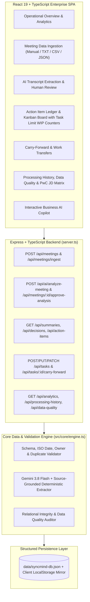
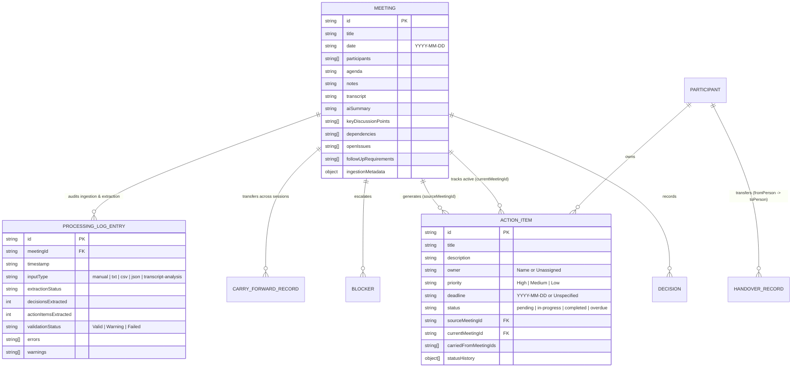

# SyncMind AI — Enterprise Meeting Data Processing & Workflow Intelligence Platform

**Live Deployment:** [https://sync-mind-wine.vercel.app/](https://sync-mind-wine.vercel.app/)

## Business Problem & Solution (PwC Data Engineering Associate Context)

- **Business Problem:** In multi-city consulting and enterprise delivery environments (Gurugram, Bengaluru, Mumbai), critical meeting information is stored in unstructured notes and verbatim transcripts. Decisions, action items, task ownership, dependencies, and follow-ups become fragmented, making operational commitments difficult to organize, validate, retrieve, and track across sessions.
- **How SyncMind AI Solves It:** SyncMind AI provides a 6-stage data engineering pipeline (`Meeting Transcript → AI Extraction → Structured Validation → Database Storage → Task Integration → Analytics`). It ingests unstructured transcripts and multi-format records (`TXT`, `CSV`, `JSON`), extracts schema-validated decisions, action items, dependencies, and follow-up requirements using **Google Gemini (`gemini-3-flash-preview`)** with a deterministic source-grounded fallback parser, validates records before saving (`Unassigned` owner / `Unspecified` ISO date checks & duplicate prevention), stores relational entities with zero orphaned references, and connects decisions to a **3-Column Kanban Workflow Board (`Pending`, `In Progress`, `Completed`)** equipped with visual **Column Task Limit (WIP Capacity) Counters** to detect consulting team bottlenecks.

---

## 1. System Architecture Diagram



---

## 2. Meeting Data-Flow Pipeline

```mermaid
LR
  A["Raw Input (Manual / TXT / CSV / JSON)"] --> B["Ingestion & Duplicate Validator"]
  B --> C["Meeting & Verbatim Transcript Store"]
  C --> D["Gemini / Deterministic Schema Extractor"]
  D --> E["Pre-Save AI Output Validator (Unassigned / Unspecified Flags)"]
  E --> F["Human-in-the-Loop Review & Approval"]
  F --> G["Structured Entities: Summary, Decisions, Action Items, Dependencies, Blockers"]
  G --> H["Kanban Execution (Pending → In Progress → Completed) & Carry-Forward Lineage"]
  H --> I["Processing History Audit Log & Executive Analytics"]
```

---

## 3. Database Entity-Relationship (ER) Diagram



---

## 4. Backend REST API Reference

| Method | Endpoint | Description |
| :--- | :--- | :--- |
| `GET` | `/api/state` | Returns the complete structured database state (`AppDatabaseState`). |
| `POST` | `/api/state/reset` | Resets workspace to the initial PwC India Q4 Business AI baseline. |
| `POST` | `/api/meetings` | Creates a validated meeting record with duplicate submission checks. |
| `POST` | `/api/meetings/ingest` | Ingests `TXT`, `CSV`, or `JSON` meeting payloads with optional auto-extraction. |
| `PUT` | `/api/meetings/:id` | Updates meeting metadata, notes, or transcript and cascades title updates. |
| `DELETE` | `/api/meetings/:id` | Deletes a meeting and its linked decisions/blockers. |
| `POST` | `/api/ai/analyze-meeting` | Extracts structured summary, discussion points, decisions, action items, dependencies, open issues, and follow-up requirements. |
| `POST` | `/api/meetings/:id/approve-analysis` | Commits human-verified AI extraction to the database and logs to `processingHistory`. |
| `GET` | `/api/summaries` | Retrieves all meeting summaries, discussion points, dependencies, and open issues. |
| `GET` | `/api/decisions` | Retrieves all formal decisions across meetings. |
| `GET` | `/api/action-items` | Retrieves all action items / tasks with status history. |
| `POST` | `/api/tasks` | Creates a validated task and prevents duplicate titles within the same meeting. |
| `PATCH` | `/api/tasks/:id/status` | Updates task status (`pending`, `in-progress`, `completed`, `overdue`) and appends audit history. |
| `POST` | `/api/tasks/:id/carry-forward` | Carries an unfinished task into a target meeting while preserving original source lineage. |
| `GET` | `/api/analytics` | Calculates live KPIs, owner workload distribution, weekly trends, and data quality summary. |
| `GET` | `/api/processing-history` | Returns chronological ingestion/extraction logs and live data quality audit. |
| `GET` | `/api/data-quality` | Runs `evaluateWorkspaceDataQuality` across all entities and relationships. |

---

## 5. AI Extraction & Data Quality Workflow

1. **Zero Hallucination Contract**: Missing task owners are strictly normalized to `"Unassigned"` and missing or non-ISO dates are normalized to `"Unspecified"`.
2. **Pre-Save Schema Validation**: `validateAIAnalysisOutput()` deduplicates extracted tasks, validates `YYYY-MM-DD` deadlines, and generates `validationWarnings` for uncertain items.
3. **Human-in-the-Loop Review**: Users can edit extracted summaries, decisions, owners, priorities, and deadlines in the **AI Intelligence** workspace before committing to the database.
4. **Idempotent Approval**: Re-approving an analysis on the same meeting prevents duplicate task, decision, or blocker creation.

---

## 6. Demo Dataset (PwC India Scenario)

The application ships with the **"Scenario: PwC India — Q4 Business AI & GenAI Delivery Review"** dataset featuring:
- **Participants**: Ananya Sharma (Director, Business AI Advisory · Gurugram), Rohan Deshmukh (Lead Business AI Engineer · Bengaluru), Priya Nair (Senior Manager, AI Governance & Delivery · Mumbai).
- **Meetings**:
  - `mtg-q4-ops-1` (*Part 1: Enterprise RAG Architecture & Guardrails* — Oct 28, 2026): Analyzed with 2 decisions, 4 tasks, and 1 active DPDP/ISO 42001 compliance blocker.
  - `mtg-q4-ops-2` (*Part 2: Production Rollout & Client Handover Sync* — Nov 2, 2026): Ready for live AI transcript extraction, carry-forward of overdue tasks, and executive report synthesis.

---

## 7. Installation & Testing Guide

```bash
# 1. Install dependencies
npm install

# 2. Start the full-stack development server on port 3000
npm run dev

# 3. Run the automated unit & integration test suite
npx tsx --test src/core/engine.test.ts

# 4. Build for production
npm run build
```
